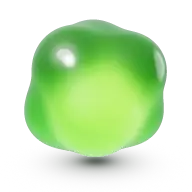

<p align="center"></p>

# Stinkshot

A local-first screenshot and screen-recording tool for Windows 11. It freezes the screen, lets you
select and annotate in place, and saves every capture to a plain folder you can use without the app.

## Features

- Region capture on a frozen snapshot of all monitors, one selection across mixed-DPI displays.
  Shift+drag adds more regions; they combine into one picture you can annotate across.
- Magnifier loupe with pixel coordinates and a hex color picker.
- Window and UI-element snapping through UI Automation. Aspect and size presets, arrow-key nudging.
- Inline annotation: arrow, line, rectangle, ellipse, pen, highlighter, text, step counters,
  callout, magnifier inset, spotlight.
- Real redaction: blur, pixelate and solid box destroy the pixels in the output.
- Annotations stay editable. Any history item reopens in the same editor.
- Window capture with Windows 11 rounded corners and alpha, optional drop shadow and padded
  background, cursor hidden by default.
- Scrolling capture: auto-scroll and stitch, with sticky header and footer handling. Waits out
  smooth scrolling, spinners and lazy-loading placeholders on its own, and crops the scrollbar.
  Full web pages: start a scrolling capture and click the page; Stinkshot snaps to the page
  itself, without the browser's tabs and toolbar (no extension, nothing leaves the PC).
- OCR with Windows.Media.Ocr: select a region, get the text on the clipboard.
- Pin any capture to the screen as an always-on-top reference.
- Screen recording to MP4 (hardware H.264 where available, AAC audio) at 30, 60 or 120 FPS, or
  size-optimized GIF.
  System audio and microphone, pause/resume, click and key visualizer, webcam bubble,
  3-2-1 countdown, trim before saving.
- History: plain image files plus a small index, background OCR, full-text search, filters by app,
  window title and date, retention by age or size (starred items are kept).
- Optional Snipping Tool replacement: Win+Shift+S, Win+Shift+R and PrtSc open Stinkshot.
- Fluent look with dark and light themes, tray icon, portable single exe.

## Privacy

Everything stays on your machine. There are no upload targets and no telemetry.

The only network call Stinkshot can make is an update check that fetches signed
release info from stinkshot.com. It is off until you turn it on in Settings, Privacy, and you can
run it manually with Check Now. It sends only what any web request carries (your IP address and a
`Stinkshot/<version>` user agent), nothing about your captures. Release info is trusted only after its
minisign signature checks out against the key built into the app. When an update is out, Update
Now (only when you click it) downloads the installer from stinkshot.com, runs it only if it matches
the SHA-256 in the signed release info, and restarts Stinkshot on the new version. See SECURITY.md.

## Install

- Installer: `Stinkshot-<version>-x64-setup.exe` from the releases page. Installs for your user
  only (no admin) to `%LOCALAPPDATA%\Programs\Stinkshot`. Silent:
  `/VERYSILENT /SUPPRESSMSGBOXES /NORESTART`, plus `/TASKS=autostart` to start with Windows.
- Portable: unzip `Stinkshot-<version>-x64-portable.zip` anywhere and run `stinkshot.exe`.

Uninstalling (Settings > Apps, or `unins000.exe /VERYSILENT`) keeps your captures, history and
settings. Each release has `SHA256SUMS` signed with minisign; SECURITY.md shows how to check it.

## Hotkeys

These are the defaults. All can be changed in Settings.

| Action | Default |
| --- | --- |
| Region capture | PrintScreen |
| Window capture | Alt+PrintScreen |
| Full screen | Ctrl+PrintScreen |
| Repeat last region | Shift+PrintScreen |
| Scrolling capture | Ctrl+Alt+S |
| OCR region | Ctrl+Alt+T |
| Record MP4 | Ctrl+Alt+R |
| Record GIF | Ctrl+Alt+G |

Taking over PrintScreen from Windows is a setting and is restored when you turn it off.

### Replace Snipping Tool

Settings > Hotkeys > Replace Snipping Tool (off by default) makes Stinkshot answer the Snipping
Tool shortcuts: Win+Shift+S opens region capture, Win+Shift+R starts Record MP4, and PrtSc is taken
over too. Only those exact key presses are intercepted; nothing else you type is touched. To undo
it, turn the setting off (or quit Stinkshot): the shortcuts go back to the Snipping Tool and the
PrintScreen setting is restored. The Snip tile in Quick Settings, the pen button and apps that open
the `ms-screenclip:` link still start the Snipping Tool, because Windows offers no supported way
to redirect them.

## CLI

With no arguments Stinkshot starts in the tray. Subcommands act on the running instance and start
it if needed.

```
stinkshot region
stinkshot window [--out FILE] [--cursor]
stinkshot full [--out FILE] [--monitor N] [--cursor]
stinkshot scroll
stinkshot ocr [--file IMAGE]
stinkshot repeat
stinkshot record
stinkshot gif
stinkshot history
stinkshot settings
stinkshot quit
```

`quit` asks the running instance to exit and waits for it; it never starts one. `window --out`, `full --out` and `ocr --file` run headless and exit. The output format follows the
file extension (png, jpg, webp). The others are handy for scripts, AutoHotkey and Stream Deck.

## Files and config

- Config: `%APPDATA%\Stinkshot\config.toml` (the settings window writes the same file).
- Log: `%APPDATA%\Stinkshot\stinkshot.log`.
- Cache: `%LOCALAPPDATA%\Stinkshot\cache` holds the About page's pre-rendered logo animation
  (a few MB, safe to delete; it is rebuilt in the background).
- Captures: the history folder set in Settings. Annotation data lives beside each image in a
  `.stinkshot` subfolder, together with the search index and thumbnails.

## Privacy

Everything stays on your PC; the only network call is the optional update check, which is off by
default.

Redaction (Blur, Pixelate and Redact boxes) destroys the pixels in the exported image. However,
with Keep Editable Originals on (the default), Stinkshot also keeps the full, unannotated original
of every annotated capture in `<history folder>\.stinkshot\edit\<file name>.base.png` so you can
re-edit it later. That original still contains whatever you redacted. If you share or sync your
history folder, or copy the `.stinkshot` folder, you share those originals too. To prevent this,
turn off Settings > History > Keep Editable Originals (existing originals can be deleted by
removing the `edit` folder), and never share the `.stinkshot` folder.

## Build

Requirements: Windows 10 or 11, Rust 1.95 or newer (MSVC toolchain), Visual Studio Build Tools with
the C++ workload and a Windows SDK.

```
cargo build --release
```

The binary is `target\release\stinkshot.exe`. Tests:

```
cargo test --workspace
cargo test --workspace -- --ignored --test-threads=1
```

The second command runs desktop integration tests that capture the real screen, use the clipboard
and install input hooks, so run it on an interactive session.

The workspace is split into `core` (image, annotation render, config), `stitch`, `history`,
`platform` (Windows APIs), `record` and `app` (UI). See `docs/ARCHITECTURE.md`.

Release builds (installer, zip, SBOM, checksums, signed update manifest): `scripts\release.ps1`,
see `docs/RELEASING.md`. Contributing: `CONTRIBUTING.md`. Changes: `CHANGELOG.md`.

## License

GPL-3.0-or-later. See `LICENSE`.
